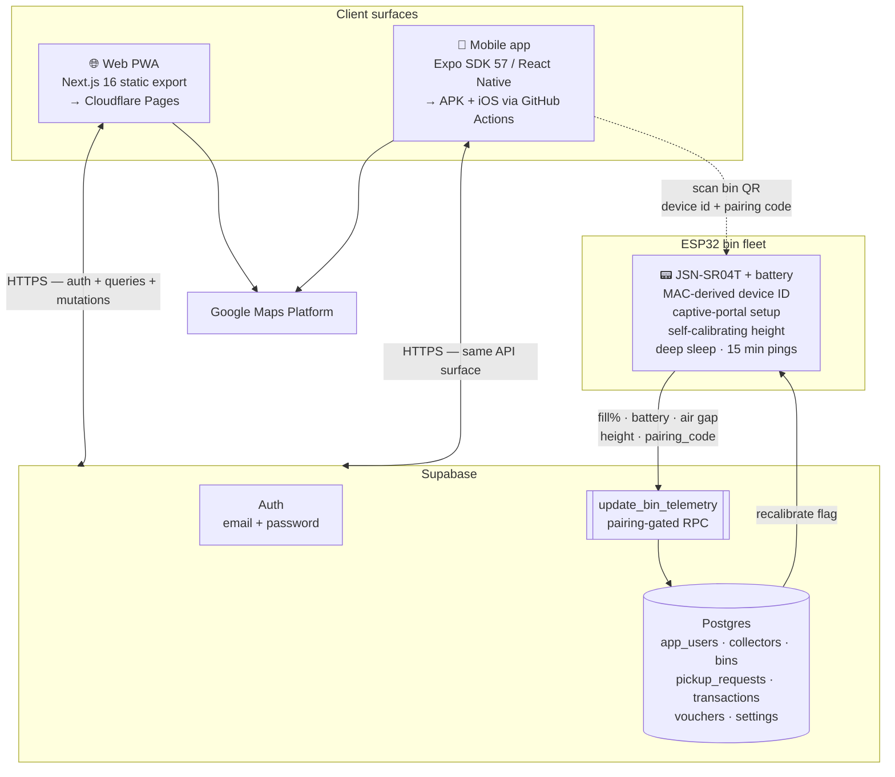
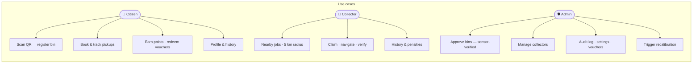
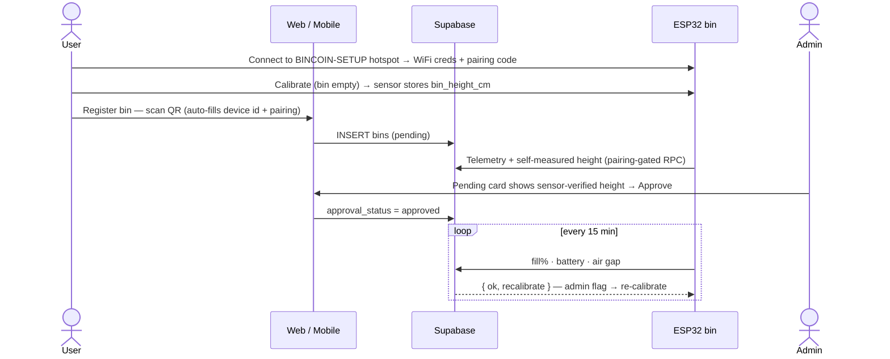

# Bincoin — Smart Waste Management Platform

One platform, three surfaces, one backend:

```
bincoin/
├── apps/
│   ├── web/        # Next.js 16 static-export PWA → Cloudflare Pages
│   └── mobile/     # React Native (Expo SDK 57) app → APK/iOS via GitHub Actions
├── firmware/       # ESP32 smart-bin firmware (self-provisioning + self-calibrating)
│   └── tools/      # QR sticker generator for fleet provisioning
├── supabase/       # Database schema + migrations (tables, RLS, telemetry RPC)
└── README.md
```

## System architecture







### Client layer (web + mobile — identical logic, two runtimes)

- **Reads**: TanStack Query hooks → `lib/supabase-data.ts` → PostgREST. Zustand store is only an optimistic/demo fallback when Supabase is unconfigured — never the source of truth.
- **Writes**: `lib/hooks/mutations.ts` → targeted Supabase `update/insert/delete` by row id → `invalidateQueries` refreshes the UI. Errors surface as toasts/alerts.
- **Auth**: Supabase Auth sessions + `app_users` role profile (citizen / collector / admin). Route guards redirect by role; pending collectors land on an approval-waiting screen.
- **Points**: pure function `lib/points.ts` — same `calcPoints` on both apps.

### Hardware layer (ESP32 fleet)

Zero per-bin code edits — one firmware image for the whole fleet:

1. **Identity** — device ID derived from the chip MAC (`ESP32-A1B2C3`), printed as a QR sticker (`BINCOIN|<id>|<pairingCode>`, generated by `firmware/tools/make-qr.mjs`).
2. **Provisioning** — first boot opens a `BINCOIN-SETUP-XXXX` captive portal: user enters home WiFi + the pairing code, then presses *Calibrate* with the bin empty.
3. **Self-calibration** — median of 15 ultrasonic reads becomes `bin_height_cm` (stored in flash + reported to the DB). The admin approval card shows this sensor-measured height — the bin proves its own geometry.
4. **Telemetry** — every 15 min: `fill% = (1 − airGap/height) × 100` + battery + air gap → `update_bin_telemetry` RPC. Writes without a matching `pairing_code` are rejected (legacy bins with no code stay open).
5. **Remote recalibration** — admin presses *Recalibrate* → sets `recalibrate_requested` → the RPC response tells the device → it re-measures and reports the new height.
6. **Recovery** — hold BOOT (GPIO0) 3 s → factory reset → back to the setup portal.

### Deploy targets

| Surface | Pipeline | Output |
|---|---|---|
| Web | `next build` (`output: export`) → Cloudflare Pages | `bincoin.pages.dev` |
| Mobile Android | GitHub Actions `build-apk.yml` on `v*` tag → `expo prebuild` + Gradle | APK attached to the GitHub release |
| Mobile iOS | Same workflow → simulator build | `.app` artifact on the release |
| Database | SQL applied in Supabase SQL Editor | `supabase/supabase/migrations/*.sql` |

| App | Stack | Repo path |
|---|---|---|
| Web PWA | Next.js 16 App Router, TypeScript, Tailwind v4, base-ui, TanStack Query, Zustand | `apps/web` |
| Mobile | Expo SDK 57, Expo Router, NativeWind, react-native-maps, expo-location, expo-camera | `apps/mobile` |
| Firmware | Arduino C++ — ESP32, JSN-SR04T, WiFi captive portal, NVS, deep sleep | `firmware/firmware/bincoin_bin` |
| Database | Supabase Postgres + Auth — `supabase/supabase/schema.sql` | `supabase` |

## Features

- **Citizen** — register smart bins by scanning the device QR (pairing-locked), book pickups (4-step wizard), track requests live, earn points, redeem vouchers with QR codes
- **Collector** — live GPS tracking with a 5 km job radius, claim jobs, navigation, verify collections (match / mismatch / invalid + photo evidence), job history
- **Admin** — live bin telemetry map, collector approvals, bin registry + approvals (with sensor-verified heights), bin recalibration, audit log, point-engine + voucher configuration
- **Hardware** — self-provisioning ESP32 bins; the DB stamps ping times (no NTP needed)

## Documentation

- Full platform docs + UML diagrams: [`apps/web/README.md`](apps/web/README.md)
- Mobile app docs: [`apps/mobile/README.md`](apps/mobile/README.md)
- Firmware wiring, provisioning & QR generation: [`firmware/firmware/README.md`](firmware/firmware/README.md)
- Database schema: [`supabase/supabase/schema.sql`](supabase/supabase/schema.sql)
- IoT pairing migration: [`supabase/supabase/migrations/002_iot_pairing.sql`](supabase/supabase/migrations/002_iot_pairing.sql)

## Quick start

```bash
# Web (local dev)
cd apps/web && npm install && cp .env.local.example .env.local  # fill in keys
npm run dev

# Mobile
cd apps/mobile && npm install && cp .env.example .env           # fill in keys
npx expo start

# Web — deploy preview in the Workers runtime
cd apps/web && npm run preview
```

## Security

- `.env*` files are gitignored in both apps; only placeholder examples are committed
- The Supabase `service_role` secret is server-only and never bundled or committed
- Build secrets (Supabase + Maps keys) live in GitHub Actions secrets / Cloudflare env vars — injected at build time, never in the repo
- Bin telemetry requires the per-bin `pairing_code` — a leaked device ID alone can't inject data
- A pre-commit hook blocks commits containing API keys/JWTs
- RLS is enabled on all tables (demo-phase permissive — tighten before public production)
