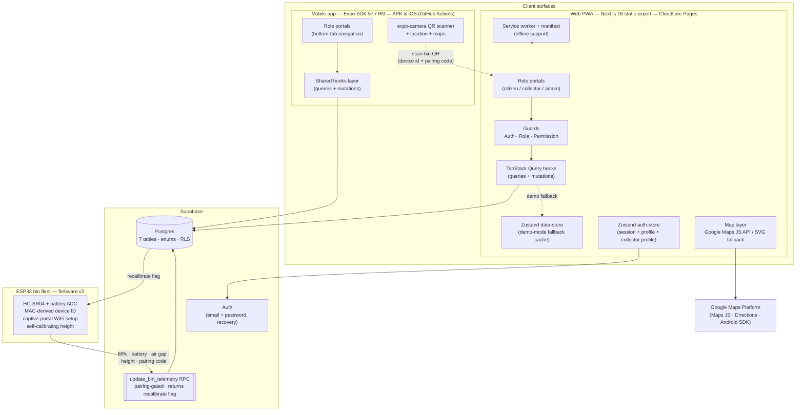
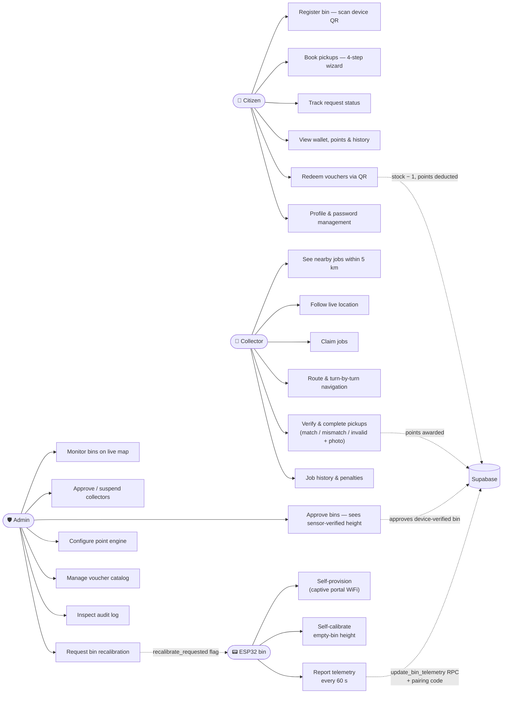
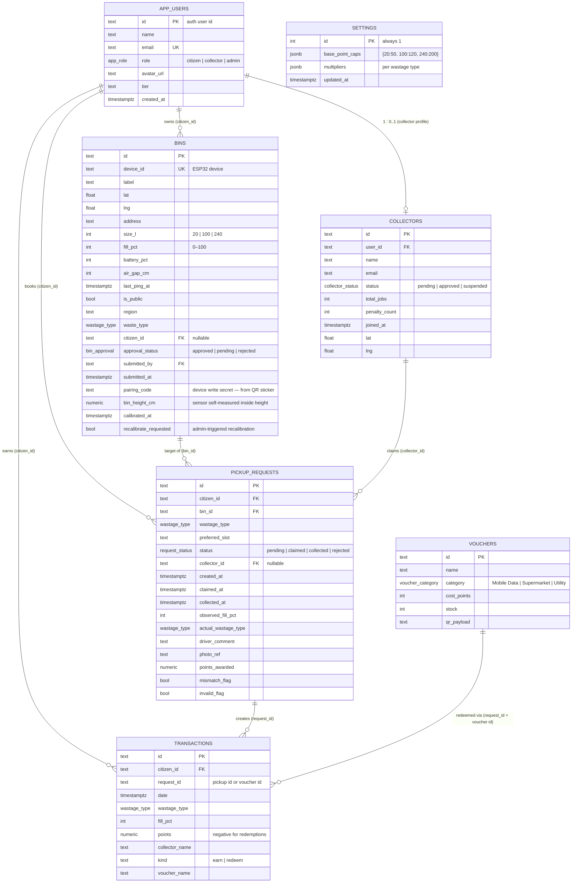
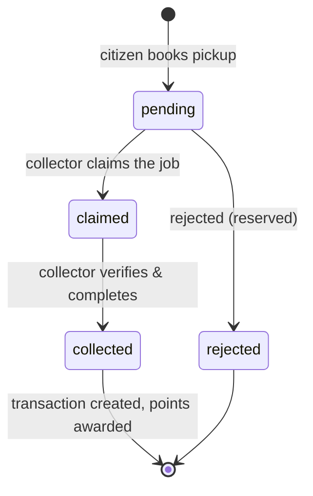
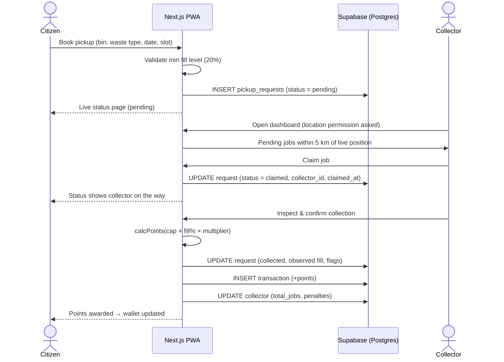
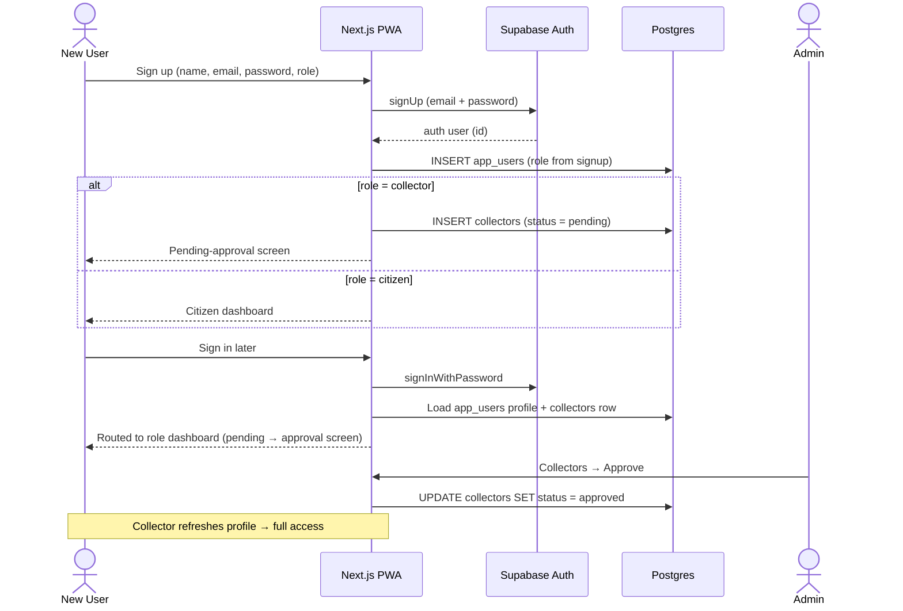
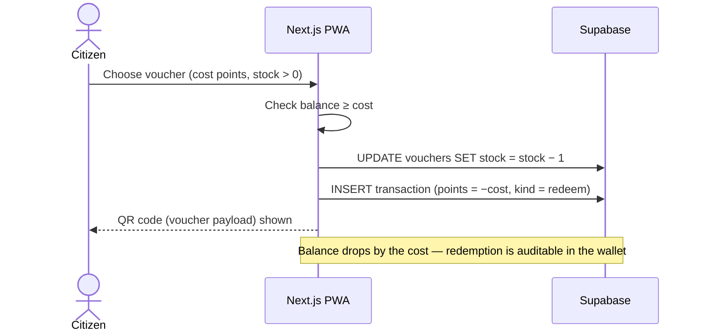
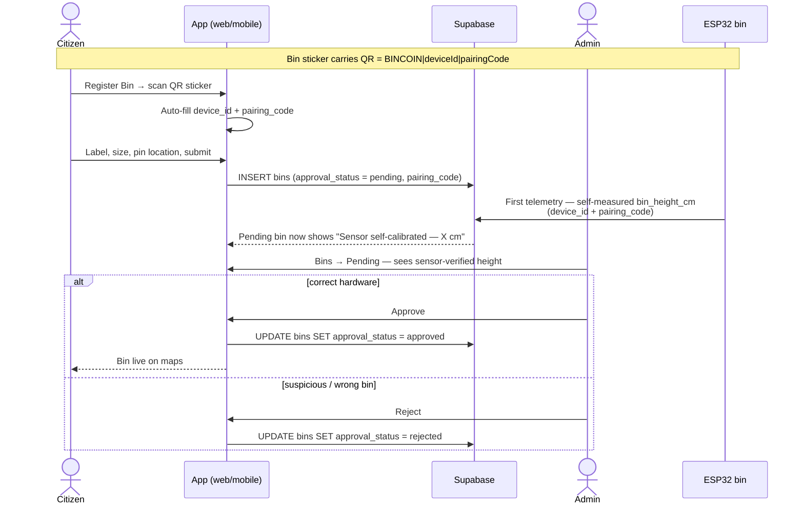
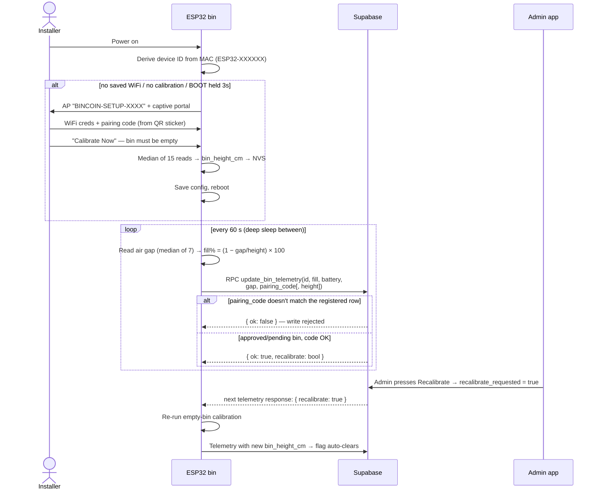
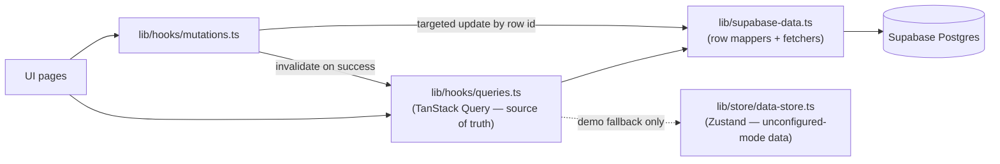

# Bincoin — Smart Waste Management PWA

Bincoin is a production-style **Progressive Web App** that digitizes municipal recyclable-waste collection. Citizens book pickups from their smart bins, collectors claim and verify collections in the field with live GPS navigation, and admins run the platform — bin registry, collector approvals, a points economy, and a voucher catalog.

Built with **Next.js 16 (App Router)**, **TypeScript**, **Tailwind CSS v4**, **Supabase** (Auth + Postgres), **TanStack Query**, **Zustand**, and **Google Maps**.

---

## Table of contents

1. [Features by role](#features-by-role)
2. [System architecture](#system-architecture)
3. [UML diagrams](#uml-diagrams)
   - [Use case diagram](#use-case-diagram)
   - [Entity–relationship diagram](#entityrelationship-diagram)
   - [Pickup request lifecycle](#pickup-request-lifecycle)
   - [Sequence: booking → claim → completion](#sequence-booking--claim--completion)
   - [Sequence: authentication & collector approval](#sequence-authentication--collector-approval)
   - [Sequence: voucher redemption](#sequence-voucher-redemption)
   - [Sequence: bin registration & approval](#sequence-bin-registration--approval)
   - [Sequence: ESP32 provisioning & telemetry](#sequence-esp32-provisioning--telemetry)
4. [Data model](#data-model)
5. [Point engine](#point-engine)
6. [Access control](#access-control)
7. [Application routes](#application-routes)
8. [Maps & location](#maps--location)
9. [Layered data flow](#layered-data-flow)
10. [Project structure](#project-structure)
11. [Authentication & password flows](#authentication--password-flows)
12. [PWA](#pwa)
13. [Environment variables](#environment-variables)
14. [Database setup](#database-setup)
15. [Getting started](#getting-started)
16. [Deployment (Cloudflare Pages)](#deployment-cloudflare-pages)
17. [Security notes](#security-notes)
18. [Verification commands](#verification-commands)

---

## Features by role

### Citizen (household user)
- Register smart bins (ESP32 device ID, size, waste type) with **location pinning** — auto-pin to current GPS location or click the map; pending admin approval
- **Book a pickup** through a 4-step wizard: bin → waste type → date & time slot → review (minimum fill-level rule enforced)
- Track request status live: *pending → claimed → collected*
- Earn points per collection; balance animates on the dashboard
- **Wallet**: transaction history with search/filter, earnings in points and LKR equivalent
- **Redeem vouchers** (mobile data / supermarket / utility) — stock-aware, points deducted, QR code issued per redemption

### Collector (driver)
- Signs up as a collector → account stays **pending until an admin approves**
- Dashboard map shows **nearby pickup jobs and critical bins (≥ 80% fill) within a 5 km radius**
- **Live location tracking** — the browser asks for location permission; the map, radius, and nearby jobs follow the collector as they move
- Claim jobs; per-job sheet shows bin details, fill level, distance/drive time
- **Route on map** (Google Directions) and **turn-by-turn navigation** (opens Google Maps — built for phones)
- **Verify collection** with three outcomes: *matches registration*, *wastage mismatch* (points recalculated by actual material), *invalid/contaminated* (0 points + penalty) — mismatch/invalid require a driver comment and photo evidence
- History: completed jobs, points issued, penalties

### Admin (system owner)
- **Operations map**: all bins with live telemetry (fill %, battery, air gap, last ping), color-coded by fill level
- **Bin registry**: register bins directly (map click to set GPS), approve/reject citizen-submitted bins
- **Collector management**: approve pending applications, suspend/reactivate, jobs & penalties per collector
- **Audit log**: master record of completed collections with mismatch/invalid flags, driver comments, photo references; search + filters
- **Settings**: point-engine configuration (base caps per bin size, multipliers per waste type) and voucher catalog CRUD

---

## System architecture



- **Reads** go through TanStack Query → Supabase. The Zustand store is only a demo-mode fallback when Supabase is unconfigured — never the source of truth.
- **Writes** persist directly to Supabase by row id, then invalidate the affected queries — the UI always reflects real server state.
- **Hardware** reports via a pairing-gated RPC; pending bins can report their self-measured height so admins can verify registrations.

---

## UML diagrams

### Use case diagram



### Entity–relationship diagram



### Pickup request lifecycle



### Sequence: booking → claim → completion



### Sequence: authentication & collector approval



### Sequence: voucher redemption



### Sequence: bin registration & approval



### Sequence: ESP32 provisioning & telemetry



---

## Data model

Seven Postgres tables (see `supabase/schema.sql`) with six Postgres enums:

| Enum | Values |
|---|---|
| `app_role` | `citizen`, `collector`, `admin` |
| `request_status` | `pending`, `claimed`, `collected`, `rejected` |
| `collector_status` | `pending`, `approved`, `suspended` |
| `bin_approval` | `approved`, `pending`, `rejected` |
| `voucher_category` | `Mobile Data`, `Supermarket`, `Utility` |
| `wastage_type` | `Plastic`, `Paper`, `Glass`, `Metal`, `Food Waste`, `Iron`, `Cardboard`, `Electronic` |

Indexes: requests by citizen/collector/status, transactions by citizen, partial index on public bins.

**Row Level Security** is enabled on every table. During the demo phase the policies are permissive (the browser uses the anon key without per-user sessions). When real per-user authorization is required, tighten the policies to `auth.uid()`-based rules — the schema file documents this.

---

## Point engine

Pure calculation in `src/lib/points.ts` (`calcPoints`), configured by the admin in Settings:

```
points = BaseCap(binSize) × (fill% / 100) × multiplier(wasteType)
points = min(points, BaseCap)        // never exceed the cap
invalid/contaminated → 0 points (+ collector penalty)
mismatch → multiplier of the ACTUAL material found
```

**Defaults**

| Bin size | Base cap (pts) |
|---|---|
| 20 L | 50 |
| 100 L | 120 |
| 240 L | 200 |

| Waste type | Multiplier |
|---|---|
| Plastic | 1.0 |
| Paper | 0.8 |
| Glass | 1.2 |
| Metal | 1.5 |
| Food Waste | 0.5 |
| Iron | 1.8 |
| Cardboard | 0.9 |
| Electronic | 2.5 |

**Citizen tiers** (lifetime points): Bronze 0+, Silver 500+, Gold 1500+, Platinum 3000+.
**Currency**: 1 point ≈ **LKR 2** (`src/lib/currency.ts`).

**Operational constants** (`src/lib/constants.ts`): minimum fill to book a pickup **20%**, critical fill threshold **80%**, collector search radius **5 km**, five preferred time slots.

---

## Access control

Implemented in `src/lib/access.ts` + guards in `src/components/guards/`:

| Capability | Citizen | Collector (approved) | Collector (pending) | Admin |
|---|:-:|:-:|:-:|:-:|
| Citizen portal (`/citizen/*`) | ✅ | ❌ | ❌ | ❌ |
| Collector portal (`/collector/*`) | ❌ | ✅ | ❌ (redirected to pending-approval) | ❌ |
| Admin portal (`/admin/*`) | ❌ | ❌ | ❌ | ✅ |
| Claim / complete jobs | ❌ | ✅ | ❌ | ❌ |

- `AuthGuard` — requires a session (redirects to `/login`)
- `RoleGuard` — role-based route access; pending collectors are routed to `/collector/pending-approval`
- `PermissionGuard` — granular permission checks with fallback UI
- Unallowed roles are redirected to their own safe dashboard

---

## Application routes

| Route | Role | Purpose |
|---|---|---|
| `/` | any | Redirects to login or the role dashboard |
| `/login` | public | Sign in / sign up (citizen or collector applicant) |
| `/forgot-password` | public | Request a password-reset email |
| `/reset-password` | public | Verify recovery link + set new password |
| `/offline` | public | Offline fallback page |
| `/citizen/dashboard` | citizen | Points balance, active request banner, recent transactions |
| `/citizen/book-pickup` | citizen | 4-step booking wizard |
| `/citizen/register-bin` | citizen | Register a bin with location pinning + approval tracking |
| `/citizen/request-status/[id]` | citizen | Live request progress |
| `/citizen/wallet` | citizen | Transactions, earnings, voucher redemption + QR |
| `/collector/pending-approval` | collector (pending) | Waiting screen + refresh |
| `/collector/dashboard` | collector | Live map: jobs, critical bins, radius, routes |
| `/collector/active-job/[id]` | collector | Job details, navigation, verification dialog |
| `/collector/history` | collector | Completed jobs + stats |
| `/admin/dashboard` | admin | Operations map + bin telemetry sheet |
| `/admin/collectors` | admin | Approvals + active collector management |
| `/admin/audit-log` | admin | Completed-collection records with flags |
| `/admin/bins` | admin | Bin registry + pending approvals |
| `/admin/settings` | admin | Point engine + voucher catalog |

---

## Maps & location

`src/components/maps/` — one `MapView` API with two engines:

- **Google Maps JS API** (`@react-google-maps/api`) — used when `NEXT_PUBLIC_GOOGLE_MAPS_API_KEY` is set
  - Custom pin markers (fill-level colored), job markers, collector dot, selection pin
  - **Theme-aware styling** — a custom dark map style in dark mode, light style otherwise
  - **Radius circle** (collector's 5 km search area)
  - **Directions** — driving route drawn with `DirectionsRenderer`; falls back to a straight line if the Directions API is disabled
- **SVG fallback map** — zero-dependency grid map with the same markers, radius, route line, and draggable collector dot; shown when no API key is configured

Location features:

- **Collector live tracking** — `watchPosition` with high accuracy; permission asked on dashboard open; map/radius/jobs follow movement; clear banners for blocked/unavailable states
- **Citizen bin pinning** — auto-pins current location when permission is already granted; otherwise an enable-location banner; manual coordinates and map-click always available; selected spot shown as a pin
- **Turn-by-turn navigation** — `https://www.google.com/maps/dir/?api=1&destination=…` links from the job sheet and active-job page (opens the Google Maps app on phones)

---

## Layered data flow



- **Queries**: `useBins`, `useBin`, `useRequests`, `useRequest`, `useTransactions`, `useCitizenTransactions`, `useVouchers`, `useCollectors`, `useSettings`, `useUsers`, `useUserName` — all refetch on mount so screens never show stale data
- **Mutations**: create/claim/complete requests, redeem vouchers, bin CRUD/approvals, bin recalibration, collector approvals, settings, voucher CRUD — each writes **directly to Supabase by row id**, then invalidates the affected queries; failures surface as error toasts
- Supabase row ↔ TypeScript object mapping is generic (camelCase ↔ snake_case) in `src/lib/supabase-data.ts`
- **PostgREST gotcha handled in code**: batch upserts union row keys and insert NULL for missing keys (not column defaults) — NOT NULL fields are always sent explicitly (`normalizeRequest`)

---

## Project structure

```
bincoin/
├── supabase/
│   └── schema.sql              # Full DB schema: enums, 7 tables, indexes, RLS
├── public/
│   ├── manifest.json           # PWA manifest
│   ├── sw.js                   # Service worker (production only)
│   └── brand/logo.jpg          # App logo
├── src/
│   ├── app/
│   │   ├── layout.tsx          # Fonts, providers, toaster, SW registration
│   │   ├── page.tsx            # Root redirect
│   │   ├── globals.css         # Tailwind v4 theme, brand palette, animations
│   │   ├── login/              # Sign in / sign up
│   │   ├── forgot-password/    # Password reset request
│   │   ├── reset-password/     # Recovery link handling + new password
│   │   ├── offline/            # Offline fallback
│   │   ├── (citizen)/citizen/  # dashboard, book-pickup, register-bin,
│   │   │                       # request-status/[id], wallet
│   │   ├── (collector)/collector/ # pending-approval, dashboard,
│   │   │                          # active-job/[id], history
│   │   └── (admin)/admin/      # dashboard, collectors, audit-log, bins, settings
│   ├── components/
│   │   ├── guards/             # auth-provider, auth-guard, role-guard, permission-guard
│   │   ├── shell/              # app-header, mobile-bottom-nav, portal-shell,
│   │   │                       # user-menu, theme-toggle
│   │   ├── maps/               # map-view, google-map-view, google-map-inner,
│   │   │                       # google-markers, svg-fallback-map, svg-markers
│   │   ├── citizen/            # points-balance-card, active-request-banner, tier-badge
│   │   └── ui/                 # base-ui component library (button, card, dialog,
│   │                           # sheet, select, tabs, table, password-input, …)
│   ├── lib/
│   │   ├── access.ts           # Roles, permissions, safe-route logic
│   │   ├── constants.ts        # Brand constants, map styles, tiers, slots
│   │   ├── points.ts           # calcPoints, haversineKm, id generation
│   │   ├── currency.ts         # LKR formatting (1 pt = LKR 2)
│   │   ├── supabase.ts         # Browser (anon) + server-only (service role) clients
│   │   ├── supabase-data.ts    # Row mappers, fetchers, persisters
│   │   ├── hooks/              # queries.ts, mutations.ts, use-mounted.ts
│   │   ├── query/              # Query keys + client
│   │   └── store/              # auth-store.ts, data-store.ts (Zustand)
│   ├── providers/              # query-provider, theme-provider
│   └── types/index.ts          # All shared TypeScript types
├── .env.local.example          # Placeholder env template
├── next.config.ts
├── public/_redirects           # Pages SPA fallback for /[id] routes
├── public/_headers             # Static asset caching headers
└── AGENTS.md                   # Repo conventions for coding agents
```

---

## Authentication & password flows

- **Supabase Auth** (email + password). The session lives in `localStorage` via supabase-js; `AuthProvider` boots it once and subscribes to auth-state changes.
- The signed-in user's **profile** (`app_users`) and **collector profile** (`collectors`) are loaded into the auth store — this drives all role-based access.
- **Sign up**: creates the auth user, the `app_users` profile row, and (for collectors) a pending `collectors` row.
- **Password reset**: `/forgot-password` → recovery email → `/reset-password` (redirect target) → new password form → auto-redirect to the dashboard. Works identically for all roles.
- **Change password**: signed-in users use the avatar menu dialog (`updateUser`).
- Legacy demo storage keys are cleaned up automatically on first load.

---

## Hardware integration (ESP32 smart bins)

Bins run the self-provisioning firmware in [`firmware/firmware/bincoin_bin/`](../firmware/firmware/bincoin_bin/): an **HC-SR04** ultrasonic sensor measures the fill level (air gap) and battery voltage, then reports via the pairing-gated `update_bin_telemetry` RPC — the **database stamps `last_ping_at`**, so devices need no NTP.

- **Zero per-bin code** — the device ID derives from the chip MAC; WiFi/pairing config enters through a `BINCOIN-SETUP-XXXX` captive portal on first boot
- **Self-calibration** — the sensor measures the empty-bin height itself; that `bin_height_cm` lands on the admin approval card so a tall-thin or short-wide bin is verified before approval, not guessed from a size label
- **Pairing codes** — each device generates its own `BINC-XXXXXX` code, shown on its setup page with the device ID; telemetry writes without the matching code are rejected
- **Remote recalibration** — admins queue it from the bins page; the RPC response flag tells the device to re-measure on its next wake
- **Factory reset** — hold BOOT (GPIO0) 3 s → back to setup mode

Full wiring and provisioning steps: [`firmware/firmware/README.md`](../firmware/firmware/README.md).

## PWA

- `public/manifest.json` — name, icons, standalone display, portrait orientation, brand colors
- `public/sw.js` — service worker registered **in production builds only** (`src/components/sw-register.tsx`)
- `/offline` fallback page for offline navigation
- Installable on phones/desktops; viewport allows user scaling; responsive layouts at every breakpoint

---

## Environment variables

Create `.env.local` (never committed — see `.env.local.example`):

| Variable | Exposure | Purpose |
|---|---|---|
| `NEXT_PUBLIC_SUPABASE_URL` | browser | Supabase project URL |
| `NEXT_PUBLIC_SUPABASE_ANON_KEY` | browser | Public anon key (safe by design; RLS applies) |
| `SUPABASE_SERVICE_ROLE_KEY` | **server only** | Bypasses RLS — never expose to the browser; the app does not need it unless server-side admin routes are added |
| `NEXT_PUBLIC_GOOGLE_MAPS_API_KEY` | browser | Google Maps JS API; without it the SVG fallback map is used |

---

## Database setup

1. Create a Supabase project.
2. Run `supabase/schema.sql` in the SQL Editor (idempotent: enums/tables/policies use `if not exists` / exception guards).
3. Seed reference data (settings row, voucher catalog, municipal bins) — either through the admin UI or SQL inserts.
4. Provision the admin account in Supabase Auth (email-confirmed) and add its `app_users` row with `role = 'admin'`.

---

## Getting started

```bash
npm install          # install dependencies
cp .env.local.example .env.local   # then fill in the values
npm run dev          # http://localhost:3000
```

| Script | Purpose |
|---|---|
| `npm run dev` | Dev server (Turbopack) |
| `npm run build` | Production build (type-checks too) |
| `npm run lint` | ESLint |
| `npx tsc --noEmit` | Type-check only |

---

## Deployment (Cloudflare Pages)

The app is a **static export** (`output: "export"` in `next.config.ts`) — all routes prerender to `out/`, and the two ID-based pages (`request-status/[id]`, `active-job/[id]`) emit a `_` placeholder that `public/_redirects` maps every real ID onto (the page reads the ID from the URL at runtime).

| Setting | Value |
|---|---|
| Root directory | `apps/web` |
| Build command | `npx next build` |
| Build output directory | `out` |
| Env vars (build time) | all three `NEXT_PUBLIC_*` values |

Supabase Auth → URL Configuration → Redirect URLs must include the deployed origin's `/reset-password` (and `http://localhost:3000/reset-password` for local development). The Google Maps key should be restricted (HTTP referrers + Maps JavaScript API).

---

## Security notes

- The **service_role secret is server-only** — it is intentionally excluded from `NEXT_PUBLIC_*` so Next.js never bundles it for the browser.
- A **pre-commit hook** (`.git/hooks/pre-commit`) blocks commits containing Supabase JWTs or Google API keys.
- `.env*` files are gitignored; only the placeholder `.env.local.example` is tracked.
- RLS is enabled on all tables; demo-phase policies are permissive — tighten to `auth.uid()`-based policies before public production use.
- Rotate any credential that has ever been shared outside `.env.local` (dashboard → API keys / database password reset).

---

## Verification commands

```bash
npx tsc --noEmit     # type-check
npm run lint         # eslint
npm run build        # production build + static generation
```

All routes are smoke-tested to return HTTP 200; auth flows are verified against the live Supabase project.
